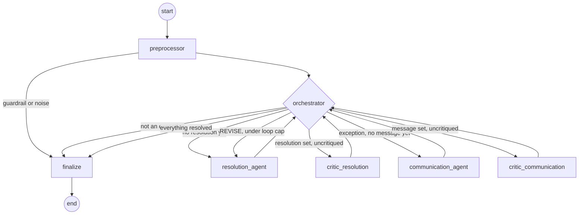

# Architecture

## Workflow graph

Every shipment flows through the same compiled LangGraph. The orchestrator
is a plain deterministic router (no LLM call) that reads state and decides
`next_agent`; it is also what enforces the automatic escalation triggers
and the two-loop revision cap, so a stubborn Critic can never spin forever.

## Agent views and PII isolation

`UnifiedAgentState` (see `src/delivery_ops/state.py`) is the single
TypedDict that moves through the graph. No node reads or writes it
directly -- each one is projected a narrower dataclass "view" first:

| View                      | Used by                 | Has customer name? |
|----------------------------|--------------------------|---------------------|
| `RouterView`               | preprocessor, orchestrator, finalize | no (full state, but no agent logic reads the name field for a decision) |
| `ResolutionAgentView`      | resolution_agent         | no |
| `CommunicationAgentView`   | communication_agent      | **yes** -- the only one |
| `CriticResolutionView`     | critic_resolution        | no |
| `CriticCommunicationView`  | critic_communication     | no |

`project_into(state, ViewClass)` filters the state down to the view's
declared fields before an agent ever sees it; `merge_back(state, output,
ViewClass)` only writes back fields the view owns. A bug in the Resolution
Agent's prompt therefore cannot leak the customer's name, because the field
was never in scope to begin with.

## Defense in depth: rules before judgment

`check_escalation_rules` (in `tools.py`) is a plain Python function, not an
LLM call. It encodes the playbook's hard-coded triggers -- 3rd attempt,
VIP with 3+ exceptions in 90 days, damaged perishable, perishable weather
delay over 4 hours (parsed from free text with a regex), fraud-pattern
addresses -- as **automatic** triggers the orchestrator enforces
unconditionally, plus two **discretionary** triggers a Critic can weigh in
on. The LLM agents are asked to respect these signals, but the orchestrator
double-checks the automatic ones regardless of what any agent decided.

Two guardrails run in `preprocessor.py` before any tool or LLM call:

- **Prompt injection**: driver notes and retrieved playbook chunks are
  scanned for a keyword list (`guardrails.INJECTION_KEYWORDS`) before they
  ever reach a prompt. A hit short-circuits the whole pipeline straight to
  `finalize` with `escalated=True` -- no agent, no tool call.
- **Noise filtering**: a routine status code (`DELIVERED`, `IN_TRANSIT`,
  `OUT_FOR_DELIVERY`, `SCANNED`) with no anomaly keyword in the description
  skips every tool call and every agent; it is classified `is_exception:
  NO` for free.

## Retrieval

The playbook PDF is chunked (800 chars, 100 overlap) and embedded with
`sentence-transformers/all-MiniLM-L6-v2` into an in-memory Chroma
collection. `search_playbook` returns the top 3 chunks with their page
numbers, which every agent prompt is required to cite in its rationale --
this is what makes the system's decisions auditable against the actual
policy document rather than the model's memorized sense of "delivery
policy."

## Evaluation

`evaluation.py` computes five metrics per shipment, matching the rubric
this project was originally built against:

1. **Task completion** -- all three of exception classification,
   resolution action and communication tone must match ground truth.
2. **Escalation accuracy** -- compared against ground truth, excluding
   shipments with no escalation label (pure noise cases).
3. **Tool call accuracy** -- did the pipeline call (or correctly skip) the
   expected tools and agents for this case.
4. **Reasoning trajectory coherence** -- an LLM-as-judge score (1-5) over
   the full decision trace, not just the final answer.
5. **End-to-end latency** -- wall-clock seconds per shipment.

`scripts/run_demo.py` runs all of this over every shipment in the dataset
and prints a per-shipment report plus the aggregate numbers.
